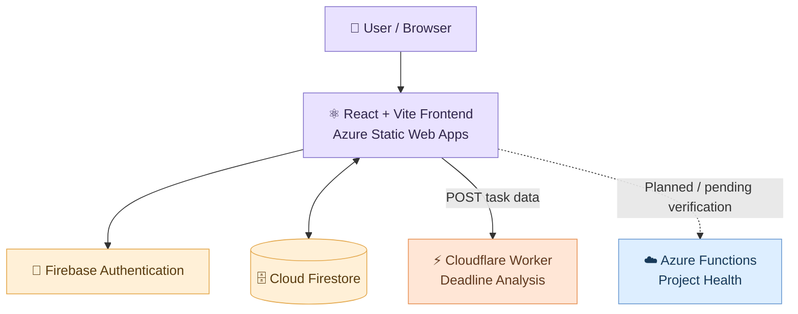

<div align="center">

# ☁️ SyncSpace
### ✦ Plan together. Stay on track. Build better. ✦

**A Multi-Cloud Collaborative Project Management & Deadline Intelligence Platform**

<p>
  <a href="https://white-smoke-042ecf200.4.azurestaticapps.net">
    
  </a>
</p>


*Bringing student teams, projects, tasks, and deadlines together — powered by three cloud providers.*

</div>

---

## 🌸 About SyncSpace

SyncSpace is a cloud-based collaboration platform designed to help student teams organise projects, manage tasks, collaborate in shared workspaces, and identify deadlines that need attention.

Built as a **multi-cloud application**, SyncSpace combines Azure, Firebase, and Cloudflare, with each provider handling a distinct responsibility.

<div align="center">

| ☁️ Cloud Provider | ✨ Responsibility |
|:---:|---|
| 🔷 **Microsoft Azure** | Frontend hosting and planned project-health computation |
| 🔥 **Firebase** | Authentication and persistent application data |
| 🟠 **Cloudflare** | Serverless deadline-risk analysis |

</div>

> 🎓 **Academic Project**
>
> Cloud Application Development (CAP 303) · TY B.Tech, Semester V  
> uGDX School of Technology, Atlas SkillTech University  
> Academic Year 2026–27

## 🌐 Live Demo

| Resource | Link |
|---|---|
| 💻 **SyncSpace Application** | [Launch the app ↗](https://white-smoke-042ecf200.4.azurestaticapps.net) |
| ⚡ **Deadline Analysis API** | `POST` [Open API endpoint ↗](https://syncspace-deadline-api.maitri-more-btech2028.workers.dev/analyze) |

> 💡 The analysis endpoint expects a `POST` request with a JSON body. Opening it directly in a browser sends a `GET` request and returns a method error.

---

## ✨ Features

<table>
<tr>
<td width="50%">

### 🔐 Authentication
Register, sign in, sign out, and track authentication state using Firebase Authentication.

</td>
<td width="50%">

### 📊 Dashboard
View projects, pending and completed tasks, overdue work, and overall progress.

</td>
</tr>
<tr>
<td>

### 🗂️ Project & Task Management
Organise work by project with task titles, assignees, priorities, statuses, and deadlines.

</td>
<td>

### 📋 Kanban Board
Track tasks across three workflow stages: **To Do**, **In Progress**, and **Done**.

</td>
</tr>
<tr>
<td>

### 🧑‍🤝‍🧑 Shared Workspaces
Keep personal data separate while collaborating with teammates in shared workspaces.

</td>
<td>

### 💌 Invitations & Membership
Invite teammates using email-linked invitation codes. Members can leave workspaces, and owners can remove members.

</td>
</tr>
<tr>
<td>

### ⏰ Deadline Intelligence
Classify tasks by deadline risk and calculate a summary score with actionable recommendations.

</td>
<td>

### 🕒 Activity Timeline
Follow recent project and task updates.

</td>
</tr>
</table>

### 🩺 Project Health

An Azure Functions endpoint is designed to calculate project-level progress metrics. **Deployment is pending verification.**

---

## 🧸 Tech Stack

| Technology | Purpose |
|---|---|
| ⚛️ React + Vite | Frontend interface and build tooling |
| 🟨 JavaScript | Frontend and service logic |
| 🔥 Firebase Authentication | User identity and sign-in |
| 🗄️ Cloud Firestore | Persistent NoSQL document database |
| 🛡️ Firestore Security Rules | Data access and authorisation |
| 🟠 Cloudflare Workers | Serverless deadline-analysis API |
| 🔷 Azure Static Web Apps | Frontend hosting and deployment |
| ☁️ Azure Functions | Intended project-health computation |
| 🐙 Git & GitHub | Version control |
| 🔗 HTTP & JSON | Communication between frontend and APIs |

---

## 🏗️ System Architecture



### 🔄 How It Works

1. **Authenticate** — Users sign in through Firebase Authentication.
2. **Load workspace** — Personal or shared workspace data is retrieved from Cloud Firestore.
3. **Manage tasks** — Task changes are written to Firestore, subject to Security Rules.
4. **Analyse deadlines** — The frontend sends task data to the Cloudflare Worker.
5. **Display insights** — The Worker classifies tasks, calculates a risk summary, and returns JSON for the frontend.

> **Architecture note:** Firestore stores application data, while the Cloudflare Worker analyses only the task data included in the request. The Worker does not query Firestore. It computes results in memory and returns JSON. Saving a task and analysing a task are separate operations.

---

## 🗃️ Firestore Data Model

| Firestore Path | Purpose |
|---|---|
| `users/{userId}/workspace/data` | User-specific workspace data |
| `workspaces/{workspaceId}` | Shared workspace record, including `ownerId` |
| `workspaces/{workspaceId}/members/{memberId}` | Workspace membership records |
| `workspaces/{workspaceId}/data/main` | Shared workspace application data |
| `inviteCodes/{code}` | Invitation-code records |

### 🛡️ Security Rules

The rules use three helper functions:

- `signedIn()`
- `isWorkspaceOwner()`
- `isMember()`

| Resource | Current Access Rules |
|---|---|
| Personal workspace | Read/write only when the signed-in UID matches the `userId` in the path |
| Workspace document | Matching owner UID required to create; members can read; owner can update/delete |
| Membership records | Members can read; eligible owners or invited users can create; owners can update; members can leave and owners can remove members |
| Shared workspace data | All workspace members can read/write |
| Invitation codes | Owners can create/delete/list; signed-in users who know a code can retrieve it; owners or eligible invited users can update it |

---

## ⏰ Deadline Analysis API

The Cloudflare Worker uses **rule-based logic, not machine learning**.

### ⚡ API Behaviour

| Request | Behaviour |
|---|---|
| `POST /` or `POST /analyze` | Analyse submitted tasks |
| `OPTIONS` | Handle CORS preflight |
| Unknown path | `404 Not Found` |
| Unsupported method | `405 Method Not Allowed` |
| Invalid JSON or non-array `tasks` | `400 Bad Request` |

Browser requests are allowed only from `http://localhost:5173` and the deployed Azure frontend.

### 🏷️ Task Risk Classification

The Worker reads deadlines from `dueDate`, `deadline`, or `due`.

A task counts as completed when `completed` is `true`, or its status is exactly `"Done"` or `"Completed"`.

| Risk Label | Condition |
|---|---|
| 🟢 `Completed` | Task is recognised as complete |
| 🔴 `Overdue` | Unfinished task with a deadline before today |
| 🟠 `Due today` | Unfinished task due today |
| 🟡 `Due tomorrow` | Unfinished task due tomorrow |
| 🔵 `On track` | Unfinished task due later than tomorrow |
| ⚪ `No deadline` | Unfinished task without a usable deadline |

The Worker adds risk labels to copies of submitted tasks. **It does not modify tasks stored in Firestore.**

### 📈 Risk Score

The API returns a summary containing:

`total` · `completed` · `pending` · `overdue` · `dueToday` · `dueTomorrow`

The risk score is calculated as follows:

```text
Risk Score = round(
  (Overdue + DueToday + DueTomorrow) / Pending × 100
)   when Pending > 0

Risk Score = 0   when Pending = 0
```

**Example**

Suppose a workspace contains 10 tasks:

| Category | Count |
|---|---:|
| Completed | 4 |
| Overdue | 2 |
| Due today | 1 |
| Due tomorrow | 1 |
| Due later | 2 |
| **Pending total** | **6** |

At-risk pending tasks = `2 + 1 + 1 = 4`

Risk score = `round(4 / 6 × 100) = 67`

The API also returns recommendations, such as prioritising overdue work, reviewing today's deadlines, or planning tasks due tomorrow.

> ⚠️ **Interpretation:** The score is an internally defined heuristic, not a statistically validated probability of missing a deadline. It does not account for task difficulty or importance.

---

## 🩺 Project Health API — Azure Functions

A `project-health` HTTP `POST` route is defined in `api/src/functions/projectHealth.js`.

It is designed to calculate:

- Total, completed, pending, overdue, and at-risk task counts
- Completion percentage
- Overall project-health label

```text
Completion % = (Completed / Total) × 100   when Total > 0
Completion % = 0                            when Total = 0
```

> 🟡 **Status: Pending verification.** The source code exists, but `/api/project-health` previously returned HTTP `404`. Do not consider this feature production-ready until the deployed route is verified.

**How it differs from deadline analysis:** Deadline analysis identifies tasks that need attention soon. Project health summarises overall progress. A project can have a high completion percentage and still contain overdue tasks.

---

## 🚦 Deployment Status

| Service | Status |
|---|---|
| Azure Static Web Apps — frontend | ✅ Deployed |
| Firebase Authentication + Cloud Firestore | ✅ Configured and in use |
| Cloudflare Worker — `/analyze` | ✅ Tested; returned HTTP 200 with valid JSON |
| Azure Functions — `/api/project-health` | 🟡 Source present; route previously returned 404, pending verification |

---

## 🚀 Getting Started

### 📦 Prerequisites

- [Node.js](https://nodejs.org/) and npm
- A Firebase project with Authentication and Cloud Firestore enabled
- A Cloudflare account, if running your own deadline-analysis Worker

### 1 · Clone the repository

```bash
git clone https://github.com/techlearnermaitri/SyncSpace.git
cd SyncSpace
```

### 2 · Install dependencies

```bash
npm install
```

If the frontend is in a subdirectory, navigate into it before running the commands.

### 3 · Configure Firebase

Create a Firebase project, add your web-app configuration to the project's Firebase initialisation module, and deploy the Firestore Security Rules.

> 🔒 **Keep secrets safe.** Never commit service-account credentials, private keys, access tokens, or other secrets. Keep environment-specific configuration out of source control where appropriate.

### 4 · Start the development server

```bash
npm run dev
```

Open the local URL printed by Vite, typically `http://localhost:5173`.

### 5 · Build for production

```bash
npm run build
```

---

## 📁 Project Structure

```text
SyncSpace/
├── src/                       # React app: components, screens, logic
├── api/
│   ├── src/functions/
│   │   └── projectHealth.js   # Azure Functions project-health handler
│   ├── host.json
│   └── package.json
├── package.json
└── README.md
```

<sub>This tree is representative. Adjust it to match the exact repository layout.</sub>

---

## 🧩 Known Limitations

- **Project health:** `/api/project-health` previously returned `404`; production deployment is not yet verified.
- **Rule-based analysis:** Deadline risk is calculated from explicit rules and a simple score. It does not predict actual delays using a trained model.
- **Worker security:** The Worker checks request origin but does not verify a Firebase ID token. CORS alone does not prevent non-browser clients from calling the endpoint. Dates use the Worker's runtime timezone, and status values are case-sensitive.
- **Firestore permissions:** All shared workspace members can write shared workspace data; there is no viewer/editor distinction. Invitation documents can be read by any signed-in user who knows the code, and invitation acceptance is not atomic.
- **Evaluation:** No benchmark, load test, or cost comparison has been performed. No performance or cost advantage is claimed.

---

## 🌱 Future Scope

- [ ] Fix and verify the Azure Functions route; connect project-health metrics to the dashboard.
- [ ] Verify Firebase ID tokens in the Worker.
- [ ] Strengthen Firestore rules with role-based access, invitation visibility controls, and atomic invitation acceptance.
- [ ] Improve deadline handling across time zones.
- [ ] Add real-time synchronisation for shared data.
- [ ] Add email or push notifications for deadlines and invitations.
- [ ] Add automated unit and integration tests for Firestore Security Rules and API responses.
- [ ] Add monitoring and historical progress analytics.

---

## 🌐 Why Multi-Cloud?

SyncSpace explores how services from three cloud providers can work together:

| Provider | Responsibility |
|---|---|
| 🔷 **Azure** | Frontend hosting and intended serverless computation |
| 🔥 **Firebase** | Identity and application data |
| 🟠 **Cloudflare** | Lightweight edge API logic |

Using multiple providers introduces separate deployment workflows, configuration, CORS setup, logging, and debugging. This project explores the practical integration of those services; it does **not** claim lower costs or better performance because neither has been measured.

---

<div align="center">

## ☁️ Made with curiosity, collaboration & a little cloud magic ✨

*SyncSpace is an academic cloud-computing project exploring collaborative application development and multi-cloud integration.*

**Thanks for stopping by! ♡**

</div>
